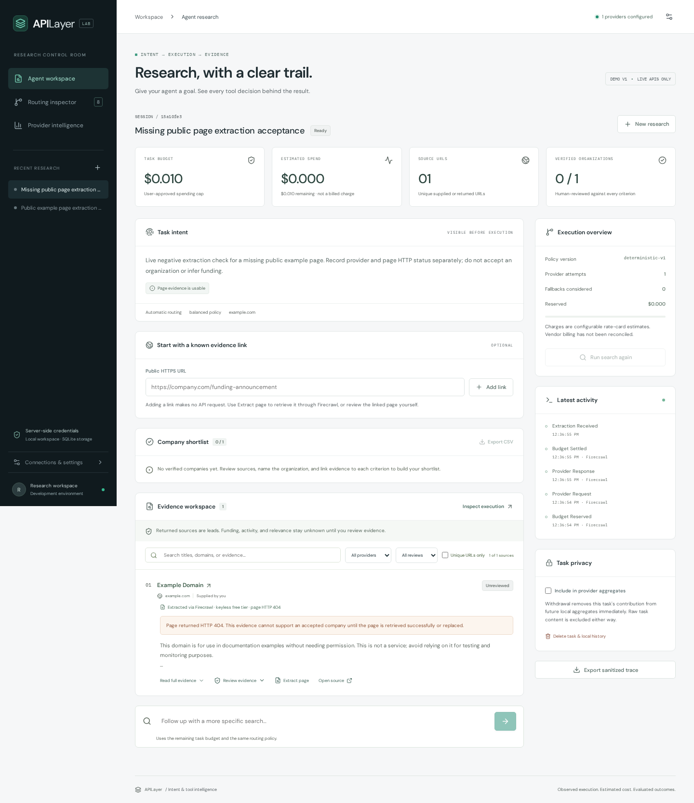
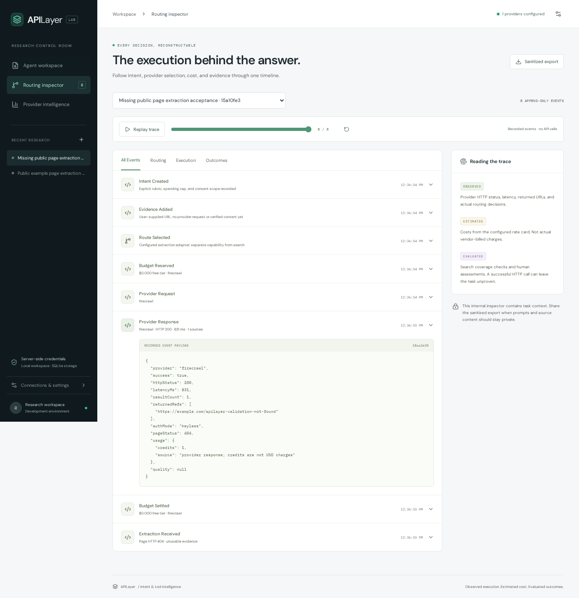
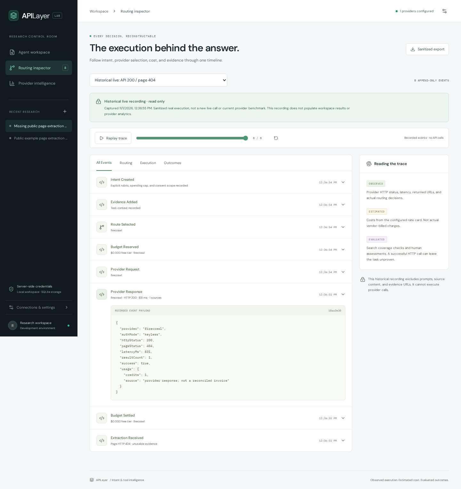

# Live validation — 1 November 2026

These observations came from real provider endpoints, not the automated fixture server. They establish the specific calls below, not general provider performance, billing reconciliation, or company verification.

## Authenticated follow-up: all three configured providers verified

After the account owner supplied server-side keys, the local production application completed the budget-gated search acceptance runner and one browser-driven page extraction.

| Provider    | Successful authenticated calls | Result                                         | Recorded usage                                 |
| ----------- | ------------------------------ | ---------------------------------------------- | ---------------------------------------------- |
| Exa REST    | 10 / 10                        | HTTP 200; 100 returned results                 | Provider reported $0.070 total; not an invoice |
| Tavily REST | 10 / 10                        | HTTP 200; 100 returned results                 | 10 credits                                     |
| Firecrawl   | 1 / 1                          | API HTTP 200; page HTTP 200; extracted content | 1 credit                                       |

The application's estimate ledger recorded **$0.250 for search and $0.001 for extraction**, with no remaining reservations. Search ran from 18:57:47 to 18:58:05 UTC; extraction completed at 19:00:26 UTC. Both tasks excluded themselves from provider analytics. The search task is `506483c0-f96e-4ab4-a814-2354ec3fb5a2`; the extraction task is `85a5eaac-91c9-4a3e-b637-3880d12cc397` in the local workspace database.

[Machine-readable authenticated result summary](live-validation/authenticated-2026-11-01.json) contains counts, status codes, timing summaries, and usage without credentials or research content. This completes the ten-successful-REST-calls-per-search-provider check. It does not establish a general speed/quality ranking, reconciled charges, or verified companies.

## Earlier keyless validation

### Working without manufacturing an account

Official current sources provide two legitimate keyless paths:

- [Firecrawl Keyless](https://www.firecrawl.dev/blog/firecrawl-keyless-launch): ordinary REST calls without Authorization, free within a daily per-IP cap. The current page describes daily limits; older indexed snippets described monthly allowances, so the current primary page takes precedence.
- [Exa MCP](https://exa.ai/mcp) and [Exa's hosted-server guide](https://exa.ai/blog/best-web-search-mcp-servers): official remote MCP without a key, subject to free rate limits.

No account was created, no identity was fabricated or asserted, no CAPTCHA or access block was bypassed, and no paid subscription was selected. At this earlier stage, standard Exa REST and Tavily access still required account-owner sign-in and server-side keys. Those were subsequently provided for the authenticated follow-up above.

## Actual observations

| Check                                        | Observed result                                                                                   | Meaning / limit                                                                              |
| -------------------------------------------- | ------------------------------------------------------------------------------------------------- | -------------------------------------------------------------------------------------------- |
| Firecrawl direct public-page scrape          | HTTP 200, success true, 959 Markdown characters, one reported credit                              | One documented keyless request worked; credits are not invoice dollars                       |
| Firecrawl through the production application | HTTP 200, 432 ms, 959 characters, zero estimated USD in the free-tier ledger                      | A real adapter request, provenance, task/call events, and ledger settlement all completed    |
| Firecrawl through the app for a missing page | Provider API HTTP 200; retrieved page HTTP 404; evidenceUsable false; zero accepted organizations | A genuine API-success / outcome-failure example, not a fabricated comparison                 |
| Exa official public MCP search               | HTTP 200, three source results in a text-only tool response                                       | Real Exa search worked via MCP; this earlier probe did not verify the REST adapter or Tavily |

Timings are single observed calls, not benchmarks. Free-tier availability can change or be exhausted. The application makes no automatic retry or paid upgrade if keyless access is refused; an explicit small session cap also limits requests.

## The actual demonstration moment

The source was `https://example.com/apilayer-validation-not-found`. The successful provider response carries the downstream page error separately. The workspace records the page as unusable and blocks accepting a company based on a known HTTP-error page. No funding, relevance, or current-activity assertion was made.

## Replay without credentials

Open Routing inspector and select **Historical live: API 200 / page 404**. The banner marks it historical, read-only, sanitized, and captured on the date above. Replay makes no provider request, creates no workspace task, and contributes nothing to provider analytics. Live workspace traces remain a separate selection. The downloaded recording is sanitized again by the same shared field allowlist as the server export.

## Reviewable evidence

- [Successful keyless extraction: sanitized trace](live-validation/firecrawl-keyless-success.json)
- [Missing-page extraction: sanitized trace](live-validation/firecrawl-keyless-missing-page.json)
- [Exa MCP probe: summary and public source references](live-validation/exa-mcp-probe.json)

The sanitized application traces omit task prompts, queries, source text, source URLs, and reviewer notes. The separately labeled MCP probe summary contains only minimal public source references, not vendor excerpts. Its result was not silently injected into the REST provider telemetry or represented as a fulfilled REST acceptance milestone.

## The deliberate boundary on Exa MCP

The inspected MCP tool returned one text block with headings and embedded page excerpts, without structuredContent. Building a production search adapter by loosely splitting that text could misattribute metadata when an excerpt itself contains similar headings. This pass records the successful connectivity/search probe rather than depending on that fragile parser or misrepresenting its output as the normalized REST contract.

## Key setup for new installations

| Provider                    | Key path                               | What is verified publicly                                                                                                                                                | Human action                                                                |
| --------------------------- | -------------------------------------- | ------------------------------------------------------------------------------------------------------------------------------------------------------------------------ | --------------------------------------------------------------------------- |
| Exa                         | https://dashboard.exa.ai               | [Free-tier pricing](https://exa.ai/pricing) advertises monthly credits plus onboarding credit without a payment method                                                   | Sign in, create a dedicated key, place it in EXA_API_KEY                    |
| Tavily                      | https://app.tavily.com                 | [Credits documentation](https://docs.tavily.com/documentation/api-credits) advertises 1,000 free monthly credits without a card; basic search uses one credit            | Sign in, create a dedicated key, place it in TAVILY_API_KEY                 |
| Firecrawl account, optional | https://www.firecrawl.dev/app/api-keys | [Onboarding guide](https://www.firecrawl.dev/agent-onboarding/SKILL.md) describes human sign-in; an account is unnecessary for the bounded keyless test that worked here | Configure FIRECRAWL_API_KEY if a higher or account-specific quota is needed |

The earlier keyless pass ended at this account-setup handoff. The account owner subsequently created the accounts and configured keys locally; the authenticated results above supersede that blocker.

After keys are supplied, run the budget-gated `smoke:live` command with the workspace server stopped, then inspect the resulting task. Do not count this MCP probe or optional extraction as ten successful Exa REST and Tavily calls.
