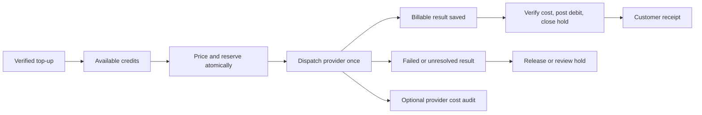

# Two Hands prepaid usage billing PRD

**Status** Draft for implementation review · **Date** November 13, 2026

## Product decision

An account owner buys prepaid Two Hands service credits in USD through Stripe Checkout. Agents on that account use the shared balance. Two Hands charges the verified USD provider cost plus a 10% markup for each eligible delivered call. It holds the maximum charge before dispatch and posts the debit after saving a billable result. The customer can trace the cost, markup, and total to the tool receipt.

This model is implementable with the existing receipt and transaction infrastructure. Production charging requires a new financial ledger, verified live top-ups, customer pricing, and end-to-end validation. Today the app tracks estimates for authorization, captures some provider usage, and reconciles eligible manually imported USD invoice lines. Its current funding ledger records test credits. [Call admission and settlement](../server/observation.ts#L689) · [Provider invoice matching](../server/provider-billing.ts#L393) · [Test credits](STRIPE_DEPOSITS.md)

### What the customer pays for

| Amount                 | Source                                                                                                                     | Purpose                                            |
| ---------------------- | -------------------------------------------------------------------------------------------------------------------------- | -------------------------------------------------- |
| Customer charge        | Verified provider cost plus 10%                                                                                            | Debit for an eligible delivered call               |
| Wallet hold            | Maximum upstream cost plus 10%, rounded up                                                                                 | Reserves enough available credit for the call      |
| Verified provider cost | Deterministic billable quantity × the applicable contracted USD rate, or a documented account-level per-request USD charge | Basis of the customer charge                       |
| Provider cost estimate | Existing configured provider rates and request options                                                                     | Protects session, API key, and operator allowances |

**Launch pricing.** Start with one bounded search configuration whose exact provider cost can be determined before dispatch from the normalized request and a verified provider account rate. Freeze the cost basis, rate version, and markup at admission. Use integer USD micros and round the markup to the nearest micro, with ties rounded up. Record the provider account reference, tool and billable options, rate version, quantity, cost evidence, provider request ID when available, base cost, markup, and total. At a verified cost of zero, the customer charge is zero. The 10% markup yields a 9.09% gross margin before payment fees and upstream costs absorbed on failed calls. Verify those economics during the pilot.

**Provider eligibility.** The published list price or the existing estimate alone is insufficient. Exa documents a per-response USD total. Confirm that it reflects the relevant account’s attributable charge before using it for settlement. Tavily documents one credit for basic search and two for advanced search. Verify the contracted USD rate and whether included credits or discounts change the attributable cost. Defer modes whose net cost cannot be attributed, including ambiguous bundles, shared rebates, or variable costs without an enforceable upstream maximum. Support response-based settlement only after validating the response meter, applicable rate, and upper bound. Firecrawl PDF scraping is an example of a variable per-page mode. [Exa Search](https://exa.ai/docs/reference/search) · [Tavily credits](https://docs.tavily.com/documentation/api-credits) · [Firecrawl billing](https://docs.firecrawl.dev/billing)

**Provider invoices.** Providers may bill Two Hands on their normal schedule. Finance can use the provider account ledger, exports, or invoices to check rate accuracy, reconcile exceptions, and measure margins. Customer calls settle from verified per-call costs. An internal invoice import and cross-account matching screen are optional later. [Existing reconciliation workflow](PROVIDER_ADAPTERS_AND_BILLING.md#comparing-bills-with-requests)

## Customer experience

1. **Add credits.** The signed-in account owner opens Credits, selects a USD top-up amount, sees any applicable tax and the service-credit amount, and pays in hosted Checkout. Credits remain pending until Two Hands verifies payment. The owner gets a payment receipt and can see the credit entry.
2. **Connect and use an agent.** The owner configures a scoped key. The agent discovers eligible tools and prices in its existing conversation. The backend checks the shared available balance and all applicable limits when the agent chooses a tool. The consumer stays in the host conversation. Funding and spend controls belong to the account owner.
3. **Review usage.** Credits shows available credits, credits held for in-progress calls, top-ups, usage debits, and adjustments. Activity shows the amount charged, tool, result status, and receipt link for each call. The receipt shows the verified provider cost, 10% Two Hands markup, and total. The account owner can export a dated statement with opening and closing balances and line items. The Stripe payment receipt covers the top-up. The usage statement explains how those credits were consumed.
4. **Recover from insufficient credits.** The agent receives a structured denial before dispatch and can continue with eligible free tools when available. The owner sees the required and available amounts in Credits. The platform sends no automatic card charge in v1.

**Labels** Use **Available credits**, **Held for in-progress calls**, and **Charged for tool calls** on Credits. Use **Spend** in the API keys list, with one dollar amount per row. During the estimate-only phase, the key’s detail view explains the estimate basis and shows its policy limit and pending amount. When production billing is enabled, the list can show posted customer charges by key once that attribution is available. Keep the key’s authorization estimates available in its details and link actual charges to Credits or Activity.

## Wallet and payment requirements

- **Ownership.** One production USD service-credit balance per personal account in hosted PostgreSQL, shared by its scoped keys. Resolve ownership from the authenticated account or key and store it on each financial event. Operators can review finance activity with a verified role. Agents may consume eligible usage and read permitted account usage. Only the account owner can start a top-up. Never use a client-supplied wallet or account ID as the authority for attribution.
- **Money.** Keep integer USD micros for usage and integer cents at Stripe. Credit the purchased service-credit principal and account separately for taxes and processor fees. Carry sub-cent usage through the ledger and round only at a clearly defined display, reporting, or payment boundary. Store raw micros in exports. Service credits apply to Two Hands’ own service. V1 scope is single currency, one funding rail, and one merchant configuration. Transfers, cash-out, crypto funding, auto-reload, and postpaid billing are deferred. Refunds, where applicable, return through the original payment rail.
- **Top-ups.** Show Checkout only after the account is eligible for the live pilot and can use at least one paid tool. Store immutable intent, account, amount, currency, mode, and request key before creating Checkout. Treat signed events as triggers and retrieve payment state from Stripe. Credit exactly once when that retrieval confirms the payment and matches the saved intent, Stripe identity, USD amount, and live mode. Give each Checkout Session and PaymentIntent one owner. Deduplicate event delivery and financial posting independently. Use a durable inbox and reconciliation job for delayed, missed, or out-of-order events. The return page displays status from the server. [Stripe Checkout fulfillment](https://docs.stripe.com/checkout/fulfillment?ui=full-page) · [Stripe webhook delivery](https://docs.stripe.com/webhooks)
- **Refunds and disputes.** For a requested refund, reserve the refundable unused paid amount before calling Stripe and link it to the original top-up. Define a deterministic top-up allocation policy, such as oldest paid credits first, so the unused amount is traceable. Use one verified net adjustment when a refund or dispute changes the original payment. Place a dispute hold or freeze paid admission while the outcome is unresolved. If a reversal exceeds unused funds, record the shortfall, suspend paid admissions, and surface it to operators. Release holds when the provider confirms reinstatement. Preserve historical usage charges and append adjustments with provenance. Apply approved refund and tax policies before live use.
- **Ledger.** Record append-only, balanced journal postings for top-up, usage, refund, dispute and manual correction. Use immutable source references, exact units, unique posting keys, and transactionally maintained balance projections that can be rebuilt from the journal. Track holds in an independently auditable lifecycle keyed to the call, with explicit outcomes. Persist financial evidence independently of research retention and exclude raw prompts, results, keys, and payment secrets from statements and analytics exports.

## Call lifecycle and failure policy

1. **Quote.** Return the exact customer price when known or a maximum customer charge for a metered call. Include rate version, quote expiry, and eligibility separately from `estimatedProviderCostMicros`. Bind the quote to the authenticated account and normalized billable options. Set an explicit maximum customer price with a quote reference or versioned tool contract. If the quote expires or price changes before admission, return a structured `quote_changed` response so the host can rediscover under account policy.
2. **Reserve.** In one PostgreSQL account transaction, check the saved request key, account eligibility, wallet availability, operator risk limit, key limit, and session limit. Write the call receipt, frozen cost basis and rate, and wallet hold before provider I/O. The hold is the maximum provider cost times 110%, rounded up to the next USD micro. Available credits equal posted balance less active holds. Concurrent keys share one lock or equivalent database serialization. Retries of the same normalized request return the existing call state. A changed payload under the same request key is rejected. [Existing provider admission](../server/observation.ts#L645) · [Workspace transaction lock](../server/database.ts#L211)
3. **Dispatch.** Record dispatch intent before the network call. Keep the provider request reference when available and use provider-side idempotency only where the provider documents it. A crash between dispatch and receipt can make upstream execution uncertain. Recover the receipt or proof where available and avoid automatic provider replay. Local billing and replay must remain idempotent even where upstream exactly-once execution is impossible.
4. **Settle.** Persist the durable customer-accessible result, usage debit, and hold closure in one transaction. Debit verified provider cost plus 10% once and release any unused hold. If verified cost exceeds the frozen maximum, release the hold, charge zero, record the exception, and alert operations. A valid zero-result search may be billable when the published SKU promises execution and a valid result response. Provider failures, unreturned results, and technical failures before a durable billable result receive zero customer charge. Their upstream cost can still count against Two Hands’ existing provider-risk estimates and later be reconciled as cost of service. A committed result can be fetched again after a lost response with the same request key and charge.
5. **Resolve uncertainty.** Show a pending hold while a bounded recovery window runs. Proposed pilot window is 15 minutes from dispatch, after checking provider timeouts and recovery behavior. If no qualifying result or authoritative cost evidence is recoverable within that window, release the customer hold, charge zero, and record the exception. Block any later automatic debit after release. Handle late provider charges in provider accounting. Alert on overdue holds, balance drift, and payment exceptions.

**Example.** A $0.007 provider cost produces a $0.0007 markup and a $0.0077 customer debit. With a $20.00 top-up, ten such calls leave $19.923. A failed call releases its hold. A later provider accounting correction goes through the audited adjustment process if it also requires a customer credit.

## Delivery and rollout

| Phase                 | Deliverable                                                                                                                                               | Exit condition                                                                                                                                                                                                                                |
| --------------------- | --------------------------------------------------------------------------------------------------------------------------------------------------------- | --------------------------------------------------------------------------------------------------------------------------------------------------------------------------------------------------------------------------------------------- |
| 1. Shadow accounting  | Versioned provider account rates, integer cost-plus pricing, ledger, quote and hold records, receipt attribution, exception reporting                     | Replay isolated fixture traffic and compare expected charges, holds, and balances. Money and provider entitlements stay in their current mode.                                                                                                |
| 2. End-to-end sandbox | Hosted Checkout sandbox, durable webhook inbox, Credits and Usage views, admission and settlement, refunds and dispute simulation                         | Complete a signed top-up, successful paid call, failure, replay, refund, and reconciliation drill in an isolated environment.                                                                                                                 |
| 3. Live pilot         | Restricted hosted accounts, one contract-verified fixed-cost tool configuration, caps on credits and upstream exposure, pricing and settlement monitoring | Merchant/payment eligibility, provider contract rights to offer this service, and operating policies for tax, receipts, refunds, retention and support are approved. A controlled live top-up and settlement match payment records and usage. |
| 4. Expand             | More endpoints and accounts, plus a documented migration path from operator-only access                                                                   | Eligible tool economics and verified cost coverage meet pilot thresholds. Access expansion is an explicit platform decision.                                                                                                                  |

Keep test balances and prior receipts isolated from production credits. Scope v1 billing to hosted customer observation calls through the canonical paid path. Legacy tasks, controlled runs, SQLite and demo traffic retain separate accounting. Verify every hosted paid entry point so it either passes through wallet admission or has an explicitly authorized internal funding path. Keep the existing operator allowance, per-key caps and session caps as separate controls during pilot. Provision the pilot operator allowance during onboarding so a valid top-up can actually unlock eligible calls. Review the transition from a lifetime manual allowance to platform risk policy before broader self-service. Support an emergency pause for new top-ups and paid calls while existing holds, payments and disputes continue reconciling. [Current operator allowances](WORKSPACE_ALLOWANCES.md) · [Current test funding boundaries](STRIPE_DEPOSITS.md)

The payment-provider decision assumes customers buy Two Hands service credits and Two Hands procures upstream services on its own behalf. Verify that commercial arrangement with Stripe and each pilot provider. Tavily distinguishes paid customer-facing applications from resale or direct API access, so get confirmation that the provider-selectable MCP integration is covered. Review the governing agreement for the actual provider account before enabling each SKU. Stripe’s invoice-applied Billing Credits product has specific limits and is separate from the real-time admission balance proposed here. [Tavily customer application guidance](https://help.tavily.com/articles/5880393096-permitted-use-customer-applications) · [Exa terms](https://exa.ai/assets/Exa_Labs_Terms_of_Service.pdf) · [Stripe Billing Credits](https://docs.stripe.com/billing/subscriptions/usage-based/billing-credits) · [Stripe business restrictions](https://stripe.com/legal/restricted-businesses)

If Finance needs an invoice workspace later, place **Provider invoices** under **Administration → Billing** for cross-account cost checks and exception review. The existing **Dashboard → Usage → Provider billing** import operates within one account. Provider accounting corrections do not automatically change a posted customer charge. Customers see top-ups and statements under **Credits** and tool receipts under **Activity**. [Current reconciliation scope](../server/provider-billing.ts#L302)

## Shadow implementation

The shadow phase records simulated admission and charges for hosted, backend-authorized API-key calls. Direct calls and routed attempts share the same accounting path. Shadow accounting neither changes tool access nor spends the test-credit balance. Reviewers can inspect the private `octolab.shadow_wallet_rates`, `octolab.shadow_wallet_holds`, `octolab.shadow_wallet_closures`, and `octolab.shadow_wallet_journal` tables. The shadow journal has no customer interface or live payment route.

- Apply migrations using the existing release procedure. Keep `TWO_HANDS_SHADOW_WALLET=false` by default.
- A database operator can enroll a specific workspace by recording a time-bounded verified USD cost for Tavily basic search with 10 maximum results, an immutable rate version identifier, and the actual server-side Tavily account and credential binding. The digest is SHA-256 over `two-hands-shadow-tavily-v1`, a NUL byte, and the exact credential, computed within the secret-handling environment. Never export the credential or its digest. A key rotation or adapter version change requires re-verification. Published estimates and included or ambiguous credits cannot establish a rate.
- Seed only simulated credit in the shadow journal. The runtime cannot enroll a workspace, set a rate, or seed the balance. A reservation denied by the shadow balance is recorded without interrupting existing dispatch. Admitted holds settle against the frozen rate even after the pilot is switched off. A failed, interrupted, or contradictory usage receipt releases the hold. The recovery and backup checks include the shadow accounting records.

The Stripe sandbox mirror is separately default-off. With `TWO_HANDS_SHADOW_STRIPE_SANDBOX=true`, a new checkout intent for an enrolled workspace can feed the simulated balance after existing Stripe test-mode payment verification. Historical test payments stay separate. Signed webhook retries converge on one deposit posting. Verified refunds and dispute holds append adjustments. A simulated shortfall or dispute prevents further shadow admissions while existing holds can settle. Existing provider authorization and the existing test-credit balance are independent of this exercise.

## Sandbox enforcement

Phase 2 is implemented behind `TWO_HANDS_WALLET_ENFORCEMENT`, default off. It uses separate `octolab.wallet_*` tables: a hold per admitted call, an append-only journal fed by verified Stripe test-mode deposits, refunds and dispute holds, and a balance projection rebuildable from the journal. Enrolled accounts are denied before dispatch with `insufficient_credits` when available credits cannot cover the hold, for every paid tool, and a lapsed or mismatched rate fails closed with `billing_unavailable`. The shadow tables keep recording independently. The operator allowance, key caps and session caps remain separate required controls; a top-up does not grant an allowance. See [wallet enforcement](WALLET_ENFORCEMENT.md).

## Live funding

Phase 3 is implemented behind `STRIPE_LIVE_ENABLED`, default off. Live Stripe has its own key, webhook secret and endpoint, every deposit and wallet row records its Stripe mode, and each mode has its own balance, so sandbox and real money cannot mix. Live deposits fund only the wallet. Operators can release a dispute freeze after Stripe closes the dispute and refund unused credits to the original card; refunds stay off until a refund policy is approved. See [Stripe live mode](STRIPE_LIVE.md).

Before a customer pilot, the owner still decides the refund policy and tax handling, confirms provider terms and rates, and activates the live Stripe account. Durable payment-event recovery beyond Stripe's retries, customer statements, and wallet enforcement on every enabled customer entry point remain to be verified.

## Customer surface

Phase 4 of the build (the PRD's "Expand" row is a rollout stage, not this work) gives the account owner one spendable balance on Credits and in the sidebar, per-call charges with provider cost, markup and total, a dated CSV statement with opening and closing balances, refusals that say what the owner can do, low-balance and frozen notices, wallet eligibility in discovery, and a top-up that is offered only when the credits could be spent. Operators get an audited adjustment action. Enrollment is still an operator step. See [customer payment surface](WALLET_CUSTOMER_SURFACE.md) for what was built, what differs from this document, and the open owner decisions.

## Acceptance and operating metrics

- **Isolation and replay.** Concurrent calls from two keys cannot reserve beyond one balance. Requests from a neighboring account, fixture, preview role, or test payment cannot mutate live credits. Replaying a request after a lost response or process restart returns one receipt and one debit at most.
- **Billing accuracy.** A supported rate change affects new valid quotes only. Success, zero results, rejection before dispatch, provider failure, timeout, crash before settlement, and late reconciliation follow the published policy. Every posted usage debit has one eligible receipt, an authoritative cost source, and the frozen cost-plus calculation. Cover zero cost, sub-cent rounding, changed rates, missing cost evidence, and cost above the hold. There are zero unexplained ledger, receipt, and payment differences at close.
- **Funding integrity.** A verified paid top-up credits once under duplicated, delayed, and out-of-order events. Wrong amount, account, environment, currency, or unconfirmed payment credits nothing. Partial refunds, refund failures, dispute wins/losses, reversals after spend, and replay converge to the verified net position. Restore and replay rebuild the same balances without duplicating postings.
- **Customer clarity.** Owners can reconcile top-up and usage statements and see why a tool is unavailable. The app never represents a provider credit, estimate, test deposit, or unmatched cost as a customer charge. Support can trace a statement line to its origin and record an auditable adjustment.
- **Pilot reporting.** Track verified top-up posting latency, stale holds, payment reconciliation exceptions, debit-to-receipt coverage, provider cost attribution coverage, gross margin by SKU, and unreconciled upstream exposure. Finance and operations set pilot amount limits, margin targets, and alert thresholds before enabling live traffic.
